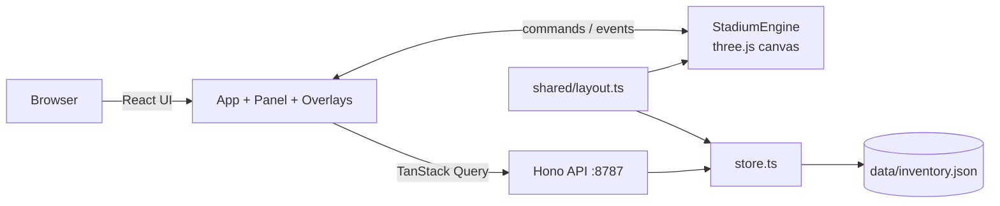
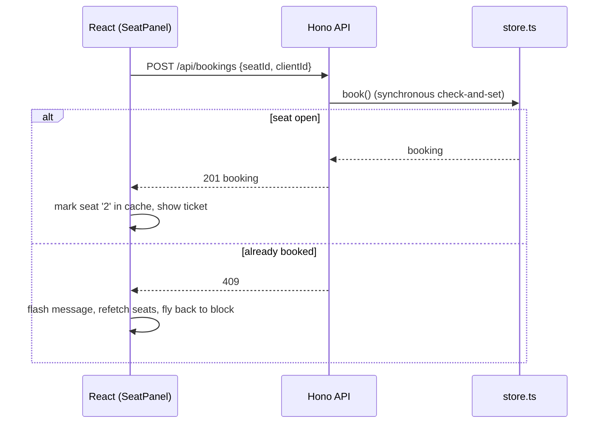

# Architecture

## Stack
| Layer | Tool | Why |
|---|---|---|
| Language | TypeScript (strict) everywhere | Preference |
| Frontend | React 18 + Vite (SPA) | Interactive tool, no SEO needs — [D-001](./Decisions.md#d-001) |
| 3D | three.js **0.147.0** (pinned) + OrbitControls + Sky | Keeps the exact look of the original — [D-002](./Decisions.md#d-002) |
| UI state | Zustand | Preference |
| Server data | TanStack Query | Caching + 15 s polling of seat inventory |
| API | Hono on Node (`@hono/node-server`), run with `tsx` | [D-003](./Decisions.md#d-003) |
| Validation | Zod (shared schema) | |
| Storage | JSON file `data/inventory.json` | [D-004](./Decisions.md#d-004) |

## System overview


## Folder structure
```
shared/        layout.ts (seat geometry, prices, seeded inventory) · api.ts (types + zod)
server/        index.ts (routes, static hosting) · store.ts (inventory + bookings file)
src/engine/    StadiumEngine.ts (scene, lighting, flights, picking) · geometry.ts · textures.ts
src/components Panel.tsx (stand/block/seat panels) · Overlays.tsx (top bar, hint, tip, ticket, loader)
src/store/     useStadium.ts (Zustand UI state)
src/lib/       api.ts · clientId.ts · layout.ts · format.ts
```

## Key flows
### Engine ↔ React
React never touches three.js objects. It calls engine commands (`goStand`, `goBlock`, `goSeat`, `back`, `setNight`, `setStatuses`, `previewStand/Block`). The engine reports back through callbacks (`onState`, `onBusy`, `onTip`, `onFlash`) which write to the Zustand store. Hover highlighting is done in the seat shader via uniforms, so it costs no React renders.

### Booking


### Shared layout
`generateLayout()` is deterministic (seeded PRNG), so the browser and the server agree on seat ids, positions, blocks and prices without sending geometry over the wire. The API only sends a 33,600-character status string.

## Security notes
- No auth (prototype). A random per-browser `clientId` in localStorage identifies "your" seats.
- Prices are computed on the server; the client only sends `seatId`.
- `/api/reset` is disabled when `NODE_ENV=production`.
